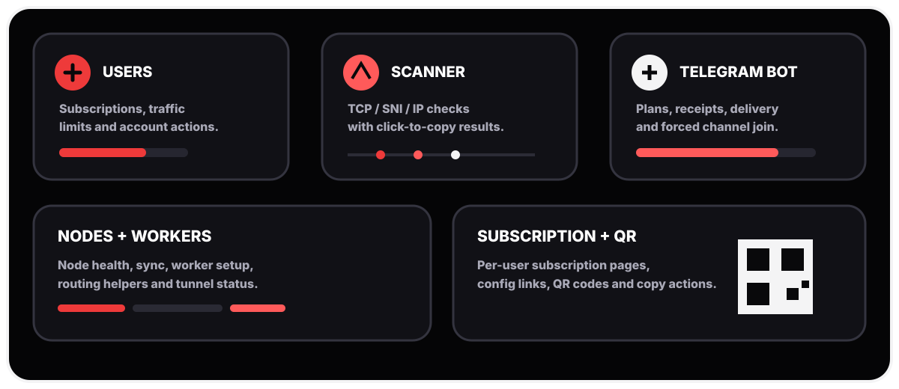
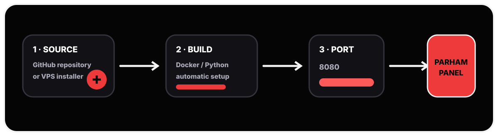
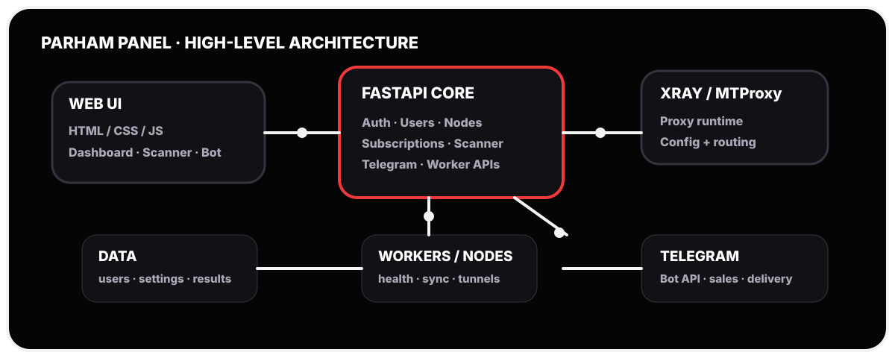

<div align="center">


<br/>
<br/>

<p>
  <a href="https://github.com/parham101112131415/parham-ui"></a>
  &nbsp;
  
  &nbsp;
  
  &nbsp;
  
  &nbsp;
  <a href="https://t.me/par1234mehr"></a>
</p>

<h3>⚡ Ultimate All-in-One Proxy & Subscription Management System</h3>
<p><b>Manage users, subscriptions, nodes, scanners, Vercel relays, and Telegram bots from a single unified panel.</b></p>
<p>VPS · Railway · Docker-ready · Parham Panel red/black neobrutalist UI — click sound effects &amp; sparks included</p>

<br/>

  <!-- Language Switcher Bar -->
  <table align="center">
    <tr>
      <td align="center"><b>🌐 Language / زبان / اللغة / Язык</b></td>
    </tr>
    <tr>
      <td align="center">
        <a href="#-english"><b>🇬🇧 English</b></a> &nbsp;|&nbsp;
        <a href="#-فارسی"><b>🇮🇷 فارسی</b></a> &nbsp;|&nbsp;
        <a href="#-العربية"><b>🇸🇦 العربية</b></a> &nbsp;|&nbsp;
        <a href="#-русский"><b>🇷🇺 Русский</b></a>
      </td>
    </tr>
  </table>

</div>

---

## 📚 Quick Navigation

- [🇬🇧 English](#-english)
  - [Core Capabilities](#core-capabilities)
  - [Deployment (VPS & Railway)](#-deployment)
  - [Public Endpoint & Subscriptions](#-public-endpoint--subscription-flow)
  - [Telegram Automation & Sell Bot](#-telegram-automation)
  - [Telegram Web Proxy (TWP)](#-built-in-web-proxy-inbound-telegram-web-proxy)
  - [Vercel Domain Relay](#vercel-domain-tls--websocket-relay)
  - [Scanner & Nodes](#-scanner)
- [🇮🇷 فارسی](#-فارسی)
  - [معرفی Parham Panel](#-parham-panel-چیست)
  - [پشتیبانی و آموزش](#-پشتیبانی-و-آموزش)
  - [نصب سریع در لینوکس و ریلوی](#-نصب-سریع-روی-vps)
  - [ربات فروش تلگرام](#-ربات-فروش-و-اتوماسیون-تلگرام)
  - [رله ورسل و وب‌پروکسی](#-وبپروکسی-داخلی-و-رله-vercel)
- [🇸🇦 العربية](#-العربية)
  - [نبذة عن Parham Panel](#-ما-هو-parham-panel)
  - [شرح التثبيت السريع](#-طريقة-التثبيت)
  - [بوت تيليجرام والمبيعات](#-أتمتة-تيليجرام-وبوت-المبيعات)
  - [الدعم والشرح](#-الدعم-والشرح)
- [🇷🇺 Русский](#-русский)
  - [Что такое Parham Panel?](#-что-такое-parham-panel)
  - [Установка (VPS и Railway)](#-развертывание)
  - [Telegram бот и продажи](#-автоматизация-telegram)
  - [Поддержка](#-поддержка)

---

# 🇬🇧 English

<div align="center">
  
</div>

## ✦ Why Parham Panel?

**Parham Panel** unifies all the operational pieces of modern proxy infrastructure into a high-performance, single-dashboard command center: users, subscriptions, generated links, dynamic QR codes, nodes, scanners, and automated Telegram bots.

<div align="center">
  
</div>

### Core Capabilities

| Area | Feature Breakdown |
|---|---|
| 👤 **Users** | Create/manage accounts, dynamic traffic quotas, expiration dates, link generation, and bulk actions |
| 🔗 **Subscriptions** | Beautiful public responsive subscription pages (`/p/<key>`), single-click client imports, and QR codes |
| 🛡 **Engine v4.0** | High-performance core, strict IP concurrency limiting, anti-domestic & anti-torrent shield |
| 🌐 **Web Proxy** | Built-in zero-configuration Telegram Web Proxy (`t.me/webproxy`) directly on port 443 via Railway/domain |
| ⚡ **Vercel Relay** | TLS + WebSocket bridge to bypass strict network blockades using serverless Edge functions |
| 🛰 **Nodes & Workers** | Multi-node management, real-time health checks, Cloudflare worker integration, sync & heartbeats |
| 🧪 **Scanner** | Ultra-fast multi-threaded TCP / IP / SNI scanner, Cloudflare IP lookup, batch ping with touch-friendly mobile copy |
| 🤖 **Telegram Bots** | Channel auto-publisher & full-featured Customer Sell Bot with plans, card-to-card receipts, and instant approval |

### License

Parham Panel is **free to use, copy, redistribute and fork — as long as it stays unmodified**. **Modifying the code or selling the software itself is not permitted.** Using the panel to run your own service is allowed. See the [`LICENSE`](LICENSE) file for the full terms.

---

## 🚀 Deployment

<div align="center">
  
</div>

### Option A — One-Command VPS Installation (Recommended)

Run the automated installer on any clean Ubuntu/Debian VPS:

```bash
curl -fsSL https://raw.githubusercontent.com/parham101112131415/parham-ui/main/start.sh | bash
```

The installer configures dependencies, `uv`, `Xray-core`, service daemons, and starts the panel on **port `8080`**.

#### Useful Installer Environment Variables

| Variable | Default | Purpose |
|---|---|---|
| `PARHAM_APP_DIR` | `/opt/Parham` | Root directory for application files |
| `PARHAM_REPO` | Project Git Repository | Git source URL |
| `PARHAM_BRANCH` | `main` | Branch to clone and maintain |
| `PARHAM_UV_VERSION` | `0.12.9` | uv release package |
| `PARHAM_XRAY_VERSION` | `26.3.27` | High-performance Xray binary |

---

### Option B — Railway One-Click Cloud Deployment

1. Fork this repository into your GitHub account.
2. Sign in to [Railway](https://railway.app/) and create a **New Project** from GitHub repo.
3. Railway detects `Dockerfile` and `railway.toml` automatically.
4. Set the service port to **`8080`**.
5. Generate a **Public Domain** in Railway settings.
6. Open `https://your-domain.up.railway.app/parham` and enjoy!

---

## 🧭 Public Endpoint & Subscription Flow

Parham Panel dynamically resolves public endpoints so you never have to hard-code changing IP addresses:

```text
Panel Architecture
  ├── /parham               → Authenticated Administration Panel
  ├── /login                → Secure Admin Login
  ├── /dashboard            → Visual System Telemetry & Statistics
  ├── /link/<uuid>          → Per-user configuration viewer
  ├── /p/<uuid_key>         → Public Responsive Subscription Page
  ├── /api/sub/<uuid_key>   → Raw client subscription payload
  └── /api/v1/ws            → High-speed Telegram Web Proxy (TWP)
```

---

## 🤖 Telegram Automation

### Channel Bot
Generates ready-to-use configurations and QR codes with custom branding and posts them automatically to your Telegram channel.

### Sell Bot (Automated Sales System)
Simple customer journey:
```text
/start  →  🛍 Products  →  Select Plan  →  Upload Receipt  →  Admin Approval  →  Instant Config Delivery
```
- Numeric Telegram Admin ID verification.
- Mandatory Channel Membership enforcement.
- Automated cleanup and customer notifications upon quota/duration expiry.

---

## 🌐 Built-in `Web Proxy` Inbound (Telegram Web Proxy)

Ships with a native **system inbound named `Web Proxy`** (`telegram-webproxy`), bound internally to port 8080 and exposed on port 443 with zero extra daemon configuration.

- Generates safe `https://t.me/webproxy?server=<DOMAIN>&secret=<USER_SECRET>` links.
- Cryptographic HMAC tokens verified via `SPIDER_TWP_SIGNING_KEY`.
- Runs alongside dashboard traffic without interfering with VLESS/Xray ports.

---

## ⚡ Vercel Domain (TLS + WebSocket relay)

Deploys a Node.js WebSocket bridge onto Vercel Edge compute:
- Uses `security=tls`, `type=ws`, and path `/ws/vl/{uuid}` on your Vercel production domain.
- Bridges traffic securely back to your primary Railway or VPS deployment.
- Bypasses network filtering via Vercel's global CDN IP pools.

---

# 🇮🇷 فارسی

<div dir="rtl">

## ✦ Parham Panel چیست؟

**Parham Panel (پرهام پنل)** یک پنل جامع، مدرن و قدرتمند برای مدیریت کامل زیرساخت‌های پروکسی، کاربران، اشتراک‌ها، نودها، اسکنرها و ربات‌های اتوماسیون تلگرام است. این نسخه با رابط کاربری شیشه‌ای (Glassmorphism)، بهینه‌سازی شده برای موبایل و دسکتاپ، و با پشتیبانی کامل از داکر، ریلوی و VPS اختصاصی ارائه شده است.

---

### 📺 پشتیبانی و آموزش

برای آموزش گام‌به‌گام نحوه نصب، تنظیم ربات فروش تلگرام، اتصال دامنه‌های Vercel و کار با اسکنر قدرتمند، در تلگرام پیام بده:

[](https://t.me/par1234mehr)

> 🔗 **پشتیبانی تلگرام:** [t.me/par1234mehr](https://t.me/par1234mehr)

---

### 🌟 قابلیت‌های کلیدی نسخه ۴.۰.۰

| بخش | توضیحات و امکانات |
|---|---|
| 👤 **مدیریت کاربران** | تعریف کاربر، محدودیت حجم، تاریخ انقضا، ساخت لینک اختصاصی و اعمال تغییرات گروهی |
| 🔗 **سیستم اشتراک پیشرفته** | صفحه اختصاصی عمومی برای هر کاربر (`/p/key`)، کد QR محلی، دکمه کپی و راهنمای اتصال |
| 🛡 **هسته ایمن و سریع** | موتور Golang پرسرعت، جلوگیری سختگیرانه از باز کردن چند کانکشن همزمان، آنتی تورنت و مسدودسازی سایت‌های داخلی |
| 🤖 **ربات فروش اتوماتیک** | تعریف پلن‌ها، دریافت فیش کارت‌به‌کارت از مشتری، تایید/رد توسط ادمین و تحویل فوری کانفیگ |
| 📡 **Telegram Web Proxy** | پروکسی داخلی وب برای تلگرام با لینک مستقیم `t.me/webproxy` بدون نیاز به نصب MTProxy جداگانه |
| ⚡ **رله ورسل (Vercel Relay)** | عبور از اختلالات و فیلترینگ شدید با تبدیل و رله ترافیک روی بسترهای بدون سرور Vercel |
| 🧪 **اسکنر پیشرفته** | اسکن IP، SNI، ساب‌نت‌های کلودفلر، پینگ گروهی و استخراج پرسرعت‌ترین سرورها |
| 🛰 **نودها و ورکرها** | مدیریت چند سرور همزمان، بررسی سلامت زنده (Healthcheck) و اتصال به ورکر کلودفلر |

---

### 📄 مجوز استفاده

استفاده، کپی، بازنشر و فورکِ نسخه‌ی **بدون تغییر** آزاد است. **تغییر کد یا فروش خودِ نرم‌افزار مجاز نیست** (استفاده از پنل برای راه‌اندازی سرویس شخصی آزاد است). متن کامل در فایل [`LICENSE`](LICENSE) موجود است.

---

### 🚀 نصب سریع روی VPS

تنها با اجرای یک دستور ساده در ترمینال لینوکس (اوبونتو / دبیان):

```bash
curl -fsSL https://raw.githubusercontent.com/parham101112131415/parham-ui/main/start.sh | bash
```

پنل روی پورت پیش‌فرض **8080** بالا می‌آید. پس از اتمام نصب، پنل از طریق آدرس زیر در دسترس خواهد بود:
```text
http://YOUR_SERVER_IP:8080/parham
```

---

### 🚂 نصب روی Railway (سرویس ابری)

1. مخزن (Repository) را در حساب گیت‌هاب خود Fork کنید.
2. وارد [Railway](https://railway.app/) شوید و یک New Project از گیت‌هاب بسازید.
3. سرویس به‌طور خودکار از `Dockerfile` بیلد می‌شود.
4. پورت سرویس را روی **8080** تنظیم کنید.
5. در تنظیمات یک Public Domain بسازید و وارد مسیر `/parham` شوید.

---

### 🤖 ربات فروش و اتوماسیون تلگرام

جریان خرید مشتری بسیار ساده و روان طراحی شده است:

```text
/start
  ↓
🛍 محصولات و تعرفه‌ها
  ↓
انتخاب پلن دلخواه
  ↓
دریافت شماره کارت و ارسال فیش
  ↓
بررسی توسط ادمین در پنل
  ├─ ✅ تایید → ارسال خودکار لینک ساب و بارکد QR
  └─ ❌ رد فیش
```

---

### 🔐 نکات امنیتی
- توکن ربات تلگرام و پسورد پنل را در مخزن عمومی قرار ندهید.
- همیشه برای دسترسی عمومی از HTTPS با دامنه معتبر استفاده کنید.
- قبل از ارائه لینک‌های اشتراک به کاربران، دامنه پابلیک را در پنل بررسی و ذخیره کنید.

</div>

---

# 🇸🇦 العربية

<div dir="rtl">

## ✦ ما هو Parham Panel؟

**Parham Panel** هي لوحة تحكم سحابية متقدمة وشاملة لإدارة خدمات البروكسي والشبكات الافتراضية، إدارة المشتركين، إنشاء روابط الاشتراكات الذكية ورموز QR، فحص الخوادم وعناوين IP، والتشغيل الآلي الكامل عبر بوتات تيليجرام.

---

### 📺 الدعم والشرح

للحصول على شرح الإعداد والتثبيت خطوة بخطوة، بما في ذلك إعدادات البوت والربط مع Vercel و Railway، تواصل عبر تيليجرام:

[](https://t.me/par1234mehr)

> 🔗 **دعم تيليجرام:** [t.me/par1234mehr](https://t.me/par1234mehr)

---

### 🌟 أبرز المميزات

| الميزة | الوصف |
|---|---|
| 👤 **إدارة المستخدمين** | إنشاء وتعديل الحسابات، تحديد الباقات وحدود الاستهلاك وتواريخ الانتهاء |
| 🔗 **صفحات اشتراك تفاعلية** | واجهة ويب متجاوبة للهواتف والحواسيب لكل عميل مع رموز QR سريعة القراءة |
| 🤖 **بوت مبيعات آلي** | استقبال الطلبات وإيصالات الدفع، تأكيد يدوي من الإدارة، وتسليم فوري للاشتراكات |
| 🌐 **بروكسی تيليجرام ويب (TWP)** | رابط سريع ومباشر `t.me/webproxy` مدمج داخل اللوحة بدون تعقيدات |
| ⚡ **محول Vercel Relay** | رله فائق السرعة عبر Edge Functions لتجاوز الحجب الصارم |
| 🧪 **فاحص الشبكات الذكي** | فحص فوري لعناوين IP، نطاقات Cloudflare، وفحص استجابة Ping مع نسخ سريع |

---

### 🚀 طريقة التثبيت

#### التثبيت المباشر على خادم Linux (VPS)

قم بتشغيل هذا الأمر في سطر أوامر السيرفر:

```bash
curl -fsSL https://raw.githubusercontent.com/parham101112131415/parham-ui/main/start.sh | bash
```

المنفذ الافتراضي للوحة هو **8080**. يمكنك الدخول للوحة عبر المتصفح:
```text
http://YOUR_SERVER_IP:8080/parham
```

#### التثبيت على سحابة Railway

1. قم بعمل Fork للمستودع في حسابك على GitHub.
2. أنشئ مشروعاً جديداً في Railway واختر المستودع.
3. حدد المنفذ (Port) على **8080**.
4. أنشئ نطاقاً عاماً (Public Domain) واستمتع باللوحة فوراً.

</div>

---

# 🇷🇺 Русский

<div align="center">
  
</div>

## ✦ Что такое Parham Panel?

**Parham Panel** — это современная, высокопроизводительная панель управления для прокси-серверов, управления пользователями, динамическими подписками, мониторингом нод, сканером подсетей и полной автоматизацией через Telegram-ботов.

---

### 📺 Поддержка

Поддержка по установке, настройке бота продаж, подключению Vercel Relay и работе со сканером — в Telegram:

[](https://t.me/par1234mehr)

> 🔗 **Поддержка в Telegram:** [t.me/par1234mehr](https://t.me/par1234mehr)

---

### 🌟 Основные возможности

| Раздел | Описание функционала |
|---|---|
| 👤 **Пользователи** | Создание аккаунтов, квоты трафика, даты окончания, блокировка мульти-аккаунтов |
| 🔗 **Подписки** | Удобная адаптивная веб-страница подписки (`/p/<key>`), QR-коды и мгновенный импорт |
| 🤖 **Telegram Бот продаж** | Каталог тарифов, загрузка чеков об оплате, ручное подтверждение админом и автовыдача |
| 🌐 **Telegram Web Proxy** | Встроенный прокси `t.me/webproxy` прямо на порту 443 без сторонних MTProxy сервисов |
| ⚡ **Vercel Relay** | TLS + WebSocket мост через Vercel Edge Functions для обхода глубоких блокировок |
| 🧪 **Сетевой сканер** | Быстрый многопоточный сканер TCP / IP / SNI, подсетей Cloudflare и пакетный пинг |
| 🛰 **Управление нодами** | Поддержка распределенных серверов, проверка доступности и Cloudflare Workers |

---

### 🚀 Развертывание

#### Быстрая установка на VPS (Linux Ubuntu/Debian) в одну команду:

```bash
curl -fsSL https://raw.githubusercontent.com/parham101112131415/parham-ui/main/start.sh | bash
```

Панель запускается на порту **8080**. Откройте в браузере:
```text
http://IP_ВАШЕГО_СЕРВЕРА:8080/parham
```

#### Развертывание на Railway

1. Сделайте Fork этого репозитория в свой аккаунт GitHub.
2. В Railway создайте **New Project** из вашего репозитория.
3. Railway автоматически соберет проект по `Dockerfile` и `railway.toml`.
4. Укажите внутренний порт **8080**.
5. Сгенерируйте Public Domain и перейдите в `/parham`.

---

## 📁 Структура проекта / Project Structure

```text
.
├── backend/                # Backend API services & controllers
├── bot/                    # Telegram bots (Sales Bot, Channel Publisher)
├── data/                   # SNI lists, Subnets, persistent storage
├── static/                 # Glassmorphic UI (HTML, CSS, JS, QR engine)
├── svg/                    # Animated vector artwork & badges
├── worker/                 # Cloudflare worker scripts
├── Dockerfile              # Docker production image
├── railway.toml            # Railway cloud deployment manifest
├── requirements.txt        # Python package dependencies
├── start.sh                # VPS installer & auto-updater
├── tm.py                   # Telegram manager daemon
├── twp.py                  # Telegram Web Proxy engine
├── vercel_relay.py         # Vercel WebSocket bridge integration
└── README.md               # Multilingual documentation
```

---

<div align="center">
  

  <h3>PARHAM PANEL 4.0</h3>
  <p><i>Modern · Fast · Resilient · Open Source</i></p>

  <p>
    <a href="https://github.com/parham101112131415/parham-ui">GitHub</a> •
    <a href="https://t.me/par1234mehr">Telegram Support</a>
  </p>
</div>
